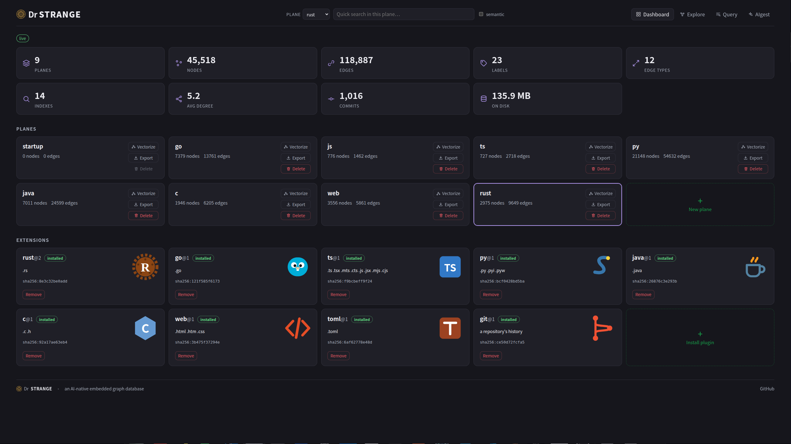
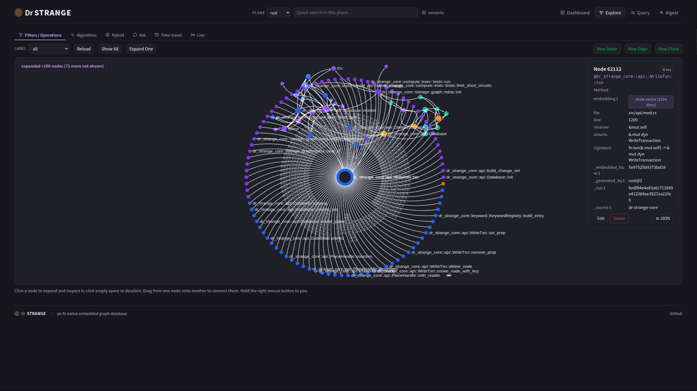
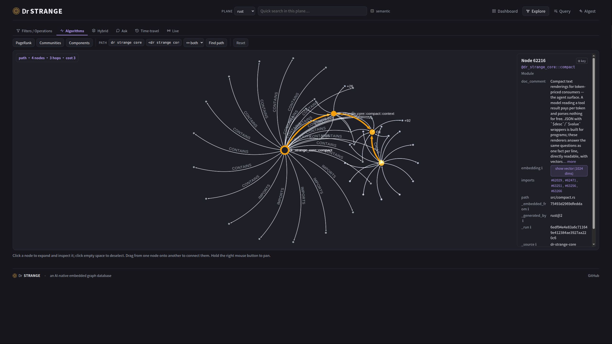
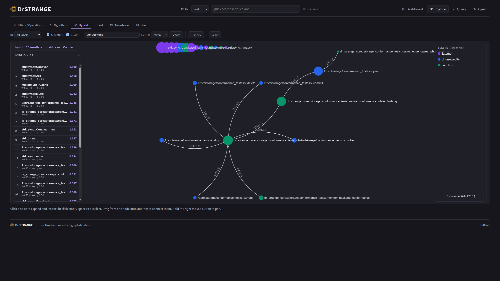
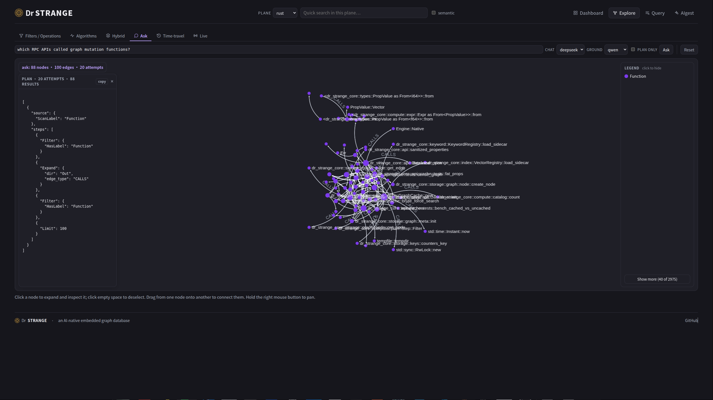
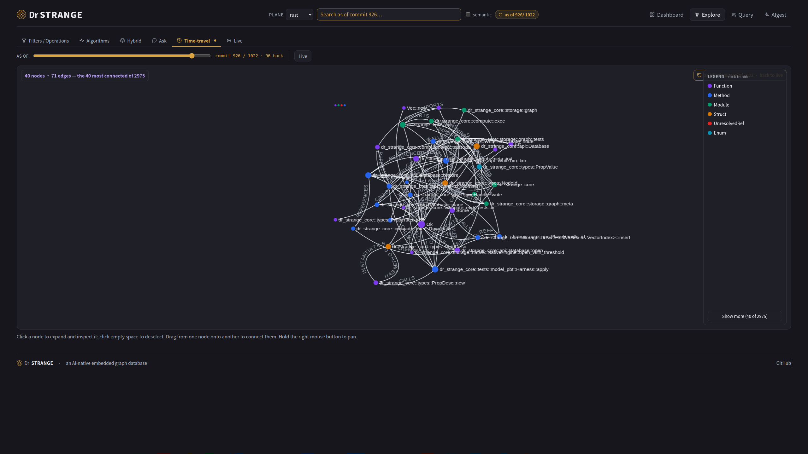

<p align="center">
  
</p>

<h1 align="center">Dr Strange</h1>

<p align="center"><em>Your coding agent asks the graph, not the files.</em></p>

<p align="center">
  <a href="https://github.com/wangyingsm/dr-strange/actions/workflows/ci.yml"></a>
  <a href="https://github.com/wangyingsm/dr-strange/actions/workflows/release.yml"></a>
  <a href="https://github.com/wangyingsm/dr-strange/actions/workflows/docs.yml"></a>
  <a href="https://github.com/wangyingsm/dr-strange/releases/latest"></a>
  <a href="https://github.com/wangyingsm/dr-strange/actions/workflows/codeql.yml"></a>
  <a href="https://scorecard.dev/viewer/?uri=github.com/wangyingsm/dr-strange"></a>
  <a href="SECURITY.md#what-ships-and-how-to-check-it"></a>
  <a href="LICENSE-MIT"></a>
</p>

<p align="center">
  <em>One command configures the agent you already use:</em><br>
  
  
  
  
  
  
  
  
  
  
</p>

<p align="center"><strong>English</strong> · <a href="README.zh.md">简体中文</a></p>

📖 **The Dr Strange Book** — the full tutorial and guide:
[English](https://wangyingsm.github.io/dr-strange/en/book/introduction.html) ·
[中文](https://wangyingsm.github.io/dr-strange/zh/book/introduction.html).

## What it costs to answer a code question

Ask an agent *what breaks if I change this*. Without a graph it greps a name
and reads whatever files matched — on this repository, a median of **53,720
tokens**. The same question against a digested graph is **925**: one `context`
call that returns the resolved callers and callees, with no file opened.

| | |
|---|---|
| Digest this repository — 97k lines, 13 parser plugins | **3.1 s**, no model in the loop |
| Answer "who calls this, and what would a change reach?" | **61× fewer tokens** (median, n=12) |

Both are measured rather than estimated, and both are reproducible.
[BENCHMARKS.md](BENCHMARKS.md#answering-a-code-question--graph-vs-text-search)
gives the method, the script, and the exclusions that keep the second number
honest — grepping a bare `new` would have made it 2,600×, which is why symbols
with generic names are left out.

## Three commands

```console
$ curl -fsSL https://raw.githubusercontent.com/wangyingsm/dr-strange/master/scripts/install.sh | sh
$ drsg plugin install          # choose parsers from the official catalog; 0 = all
$ drsg init                    # digest, serve, and write the MCP config your agent reads
```

`drsg init` digests the working tree, spawns a watcher that folds every commit
into the graph, and writes `.mcp.json` plus a matching config for whichever of
the agents above this repository or your machine shows a sign of. Your agent then has
`context`, `impact`, `trace`, `wire`, `grep` and the rest — one round trip each.
No model is involved in any of it.

## Introduction

It is also a graph database — one designed from the outset for AI workloads:
embeddings are a first-class value type, similarity search operates alongside
graph traversal, and the engine exposes primitives suited to agents — natural
language queries, a live change feed, and time-travel — rather than adding AI
features to a conventional graph database after the fact.

Like SQLite, it is **embedded**: a library linked into an application, backed by a
single on-disk database, with no server to operate. Unlike SQLite, it can also
**serve** — `drsg serve` exposes a JSON-RPC 2.0 API, a browser dashboard, and a
WebSocket change feed, with client SDKs in six languages.

The code intelligence above is built on the same engine. Sandboxed wasm parser
plugins digest a repository into a graph of symbols and resolved relationships
— thirteen official plugins, eight of them languages, no model in the loop. `drsg serve watch` keeps that graph synced to
every commit, and a compact set of agent tools answers structural questions —
who calls this, what breaks if it changes, how does X reach Y — in one round
trip. See [For coding agents](#for-coding-agents).

For applications built around a knowledge graph, a GraphRAG pipeline, or an
agent's long-term memory, Dr Strange aims to be the single store for all of it.

## Web UI screenshots

`drsg serve` ships a browser console. More of it in the [Web UI
chapter](https://wangyingsm.github.io/dr-strange/en/book/web-ui.html).

<table>
  <tr>
    <td width="50%"><a href="screenshots/00.png"></a><br><sub><b>Dashboard</b> — live counts across every plane, plane management, and the installed parser plugins</sub></td>
    <td width="50%"><a href="screenshots/01.png"></a><br><sub><b>Explore</b> — the graph as it stands, with one node open: file, line, signature, and the plugin that asserted it</sub></td>
  </tr>
  <tr>
    <td width="50%"><a href="screenshots/04.png"></a><br><sub><b>Shortest path</b> — the route between two symbols, its hops and cost, drawn over the neighbourhood it crosses</sub></td>
    <td width="50%"><a href="screenshots/05.png"></a><br><sub><b>Hybrid</b> — fused vector + keyword + graph-proximity search, each hit showing what every channel contributed</sub></td>
  </tr>
  <tr>
    <td width="50%"><a href="screenshots/06.png"></a><br><sub><b>Ask</b> — a plain-language question turned into a read-only plan, shown and then run</sub></td>
    <td width="50%"><a href="screenshots/07.png"></a><br><sub><b>Time-travel</b> — the same plane as of an earlier commit, on a slider over its history</sub></td>
  </tr>
</table>

## Features

| Capability | What it gives you |
|---|---|
| **Planes** | many independent graphs in one database |
| **First-class embeddings** | vector properties, natively HNSW-indexed |
| **Hybrid retrieval** | fused vector + keyword (BM25) + graph-proximity search |
| **Query language** | a serializable logical plan and an openCypher subset |
| **Graph algorithms** | PageRank, connected components, shortest path, Louvain |
| **Natural-language query** | ask in plain language → plan → run |
| **Time-travel** | read the graph *as of* a past commit or timestamp |
| **Change feed** | subscribe to a plane and receive mutations live |
| **Code digestion** | sandboxed wasm parser plugins turn a repository into a resolved call graph — thirteen official plugins, an SDK for community parsers |
| **Commit-synced watch** | `serve watch` folds every commit into the plane, convergent with a full re-digest |
| **Agent tools** | `context` · `search` · `describe` · `grep` · `trace` · `impact` · `fathom` · `snippet` · `history` · `deployed` · `recall` · `wire` — one round trip each |
| **Attached planes** | `drsg attach` records that one plane may ask another — on this instance, or another drsg at a URL — so `impact --across` and `wire` answer across repositories |
| **Mounted databases** | `drsg mount` serves another database's planes on a **running** server, each keeping its own name, writer and lifecycle; nothing is copied or re-digested |
| **Backup / restore** | consistent, id-faithful whole-database snapshots |
| **Read-only replicas** | `serve --follow` mirrors a running server for read-scaling across a cluster |
| **Interfaces** | a web UI, six language SDKs, a CLI, and an MCP server speaking the agent verbs |

The model-backed features (natural-language query, document ingestion, and
text-embedding search) call an external or local LLM; everything else runs with
no model at all. See [Appendix C](https://wangyingsm.github.io/dr-strange/en/book/appendix-c.html).

## Install

One line, no toolchain. The installer downloads the released binary for your
platform, verifies its SHA-256, and puts it on your `PATH`. Two binaries ship:
the CLI and server `drsg`, and the stdio MCP server `drsg-mcp`.

**Linux and macOS** (Apple silicon and Intel)

```console
$ curl -fsSL https://raw.githubusercontent.com/wangyingsm/dr-strange/master/scripts/install.sh | sh
```

**Windows** (PowerShell)

```console
PS> irm https://raw.githubusercontent.com/wangyingsm/dr-strange/master/scripts/install.ps1 | iex
```

`--bin drsg-mcp` installs the MCP server instead, `--bin all` both;
`--version vX.Y.Z` pins a release and `--dir <path>` chooses the destination
(default `~/.local/bin`, or `%LOCALAPPDATA%\Programs\drsg\bin`). On Windows
the flags are `-Bin`, `-Version`, `-Dir`, and passing any of them needs the
script run as a block rather than piped to `iex`:

```console
PS> & ([scriptblock]::Create((irm https://raw.githubusercontent.com/wangyingsm/dr-strange/master/scripts/install.ps1))) -Bin drsg-mcp
```

**On a slow network.** GitHub serves the releases, and from some networks that
is reachable but slow enough to look like a hang. `--mirror <base-url>`
(`DRSG_MIRROR`, `-Mirror` on Windows) names a mirror holding the same layout:
GitHub is tried first, and the mirror takes over if that attempt is failing or
crawling. The SHA-256 is verified whichever source answers, so a mirror is
trusted for availability and never for content. `--no-mirror` forbids the
fallback; without a mirror configured nothing changes, and a slow download is
left to finish rather than abandoned.

**Staying current.** `drsg update` asks GitHub for the latest release and, if
this build is behind it, hands the process over to the installer above —
pointed at the directory `drsg` runs from, so the copy on your `PATH` is
replaced rather than joined by a second one, and a `drsg-mcp` beside it is
updated with it. A build already current is told so and nothing is downloaded.

Alternatives: the container image `ghcr.io/wangyingsm/dr-strange:latest`, the
archives and checksums on the [releases
page](https://github.com/wangyingsm/dr-strange/releases), or from source with a
[Rust toolchain](https://rustup.rs) — `cargo build --release -p drsg`,
after `just web-build` ([bun](https://bun.sh)), since the dashboard is embedded
at compile time and the binary otherwise ships a placeholder page.


## Getting Started

```console
# Create a plane, add data, and query it.
$ drsg --db graph.drsg plane create social
$ drsg --db graph.drsg cypher --plane social \
    'CREATE (a:Person {name:"Ada"})-[:KNOWS]->(b:Person {name:"Alan"})'

# Serve the dashboard + API.
$ drsg --db graph.drsg serve
```

The full walkthrough — building, the on-disk layout, embeddings and similarity
search, the server and its configuration, and the container image — is in the
book's **Getting Started** chapter:
[English](https://wangyingsm.github.io/dr-strange/en/book/getting-started.html) ·
[中文](https://wangyingsm.github.io/dr-strange/zh/book/getting-started.html).

## For coding agents

Dr Strange treats a codebase the way it treats any other knowledge: as a
graph. Parser plugins — sandboxed wasm components, one per language — turn
source files into symbols and resolved relationships (CALLS with call sites,
REFERENCES, IMPORTS, EXTENDS, …), with no model in the loop. `serve watch`
then follows the repository commit by commit, so the graph an agent queries is
the code as committed — and each answer opens by saying which commit
(`synced: commit <sha>`).

`drsg init` is the one-command path: it digests the tree, spawns `serve watch`
detached, and writes the MCP config. It is safe to re-run and is the way back
whenever the server is gone — nothing restarts it, since an MCP `http` entry
says where to connect, not what to launch. A live server is left alone; a dead
one comes back on the *same* address and token, so every agent's configuration
stays valid and the plane resumes from its recorded commit instead of
re-parsing.

```console
$ drsg init                       # already up: nothing to do
drsg is already serving . at http://127.0.0.1:51900/mcp — reusing it, the plane is untouched
```

Pinning `addr` and `token` under `[server]` in `drsg.toml` keeps the endpoint
byte-identical across restarts. The longer path — digest, serve and query as
separate steps — is in the [Coding Agent
chapter](https://wangyingsm.github.io/dr-strange/en/book/coding-agent.html).

Twelve verbs answer an agent's questions, one round trip each, as compact
one-fact-per-line text. All twelve are MCP tools on `drsg serve`, and all
twelve are CLI subcommands.

| Verb | The question it answers |
|---|---|
| `context` | everything about one symbol — definition, callers with call sites, callees, references — the primary verb |
| `search` | "I don't know the name": semantic top-k over the plane's embeddings |
| `describe` | one symbol's properties — the lightweight node-only view |
| `grep` | text over the watched source tree — literal or regex, path-scoped, with context lines; each hit names the symbol it falls in |
| `trace` | how one symbol reaches another: the shortest recorded call path |
| `impact` | blast radius: everything reaching a symbol, grouped by distance — and, asked `--across`, which other repositories it reaches |
| `fathom` | what kind of place a symbol sits in: the region within a few hops, by label and edge type, with its hubs |
| `snippet` | a symbol's source text, or a range of a file (`path:start-end`) — the `sed -n` an agent no longer needs |
| `history` | the repository behind the code: HEAD, branches, tags, rebases and the newest commits |
| `deployed` | what commit a running thing was built from, and what runs a commit — the manifests' ops plane joined to the history beside it |
| `recall` | the same code as it was: a file, a symbol's declaration then, a search of the old tree, or what changed since an older revision |
| `wire` | what serves an HTTP path and what asks for it — matched across every language in the plane, and across the planes it attaches |

Two disciplines run through every tool. An ambiguous name is never guessed at:
the reply is a list of candidates to pick from. And a call listing is a stated
lower bound — what the parser could not resolve is kept as `UnresolvedRef`
facts with reasons, and the answer says so. A wrong edge is worse than a
missing one.

**History, too.** Digesting a git checkout also reads the repository's history
into a plane of its own, `<plane>_git`: commits, branches, tags, merges, and
the rebases only the reflog remembers. Facts only, no model call and no `git`
binary — the `git` plugin reads the object store itself, inside the sandbox.
Two planes, because the code plane is the tree *now* while history only grows.
`--no-git` turns the stage off.

**Routes, across repositories.** A page calls `/api/v1/orders/42`; a controller
declares `@GetMapping("/api/v1/orders/{id}")`; the graph holds both files and
no connection between them. The Go, Java, Python, Rust and TypeScript plugins
record the routes a symbol states — `serves` for a declaration, `requests` for
a call — in one vocabulary, `GET /api/v1/orders/{}`, whatever framework wrote
it. `wire` computes the correspondence when asked, stores nothing, and says
what it could not match. Frontend and backend are usually different
repositories, so `drsg attach` records the one fact that joins them, *this
plane may ask that one* — a plane on this instance, or one another drsg serves
at a URL, read over the `plane.query` every drsg already has.

**A shared library and its dependents.** "Which business repositories would
this change break?" is `impact --across`, answered through two keys both sides
already state: the coordinate a build declares, and the symbol a dependent's
source stands in for. Nothing is derived and no plugin needed changing — a
library's own `pom.xml` says which coordinate it publishes. `--across` reads
the planes this one attaches; `--across all` reads every plane the instance
holds, so a machine handed thirty repositories needs no setup to be asked
across them.

**One server, many repositories.** Thirty-four repositories would otherwise be
thirty-four databases, each costing a process, a port and its own cache.
`drsg mount` serves another database's planes on a **running** drsg, keeping
their names, so `--plane svc-orders` works as before. Nothing is copied or
re-digested: each store keeps its own files, **its own writer** — so the folds
run in parallel rather than queueing behind one gate — and its own lifecycle.
Mounts are written down and served again after a restart, and are confined to
the one directory `[server] mount_root` grants.

**Plugins.** `drsg plugin install` installs any parser plugin — an official
plugin's name, a local `.wasm`, or a URL — validating it as a component and
pinning its SHA-256, re-checked at every load. The catalog lives in
[dr-strange-extension](https://github.com/wangyingsm/dr-strange-extension)
rather than compiled in, so a plugin release needs no drsg release. The same
repository carries the plugin SDK: the parser contract is a public WIT
interface, and a community parser is a first-class citizen of the catalog.

**Agent-side tooling.** The Claude Code hooks, the shared long-term memory
daemon, and the router that puts several repositories behind one MCP surface
live in
[`drsg-harness-kit`](https://github.com/maidol/drsg-harness-kit) (Linux, Claude
Code only) — drsg itself stays client-neutral and depends on none of it.

**How it compares.** In agent-task benchmarks against a ripgrep-driven workflow
and two open-source code-graph MCP tools, drsg completed every task shape in
2–4 tool calls at the lowest marginal token cost, and was the only tool whose
answers state their own bounds:
[AGENT-BENCHMARKS.md](AGENT-BENCHMARKS.md).


## Documentation

The book covers each part in depth:
[AI Native](https://wangyingsm.github.io/dr-strange/en/book/ai-native.html) ·
[Query Language](https://wangyingsm.github.io/dr-strange/en/book/query-language.html) ·
[Web UI](https://wangyingsm.github.io/dr-strange/en/book/web-ui.html) ·
[SDK](https://wangyingsm.github.io/dr-strange/en/book/sdk.html) ·
[Embedded CLI](https://wangyingsm.github.io/dr-strange/en/book/embedded-cli.html) ·
[MCP](https://wangyingsm.github.io/dr-strange/en/book/mcp.html) ·
[Plugins](https://wangyingsm.github.io/dr-strange/en/book/plugins.html) ·
[Coding Agent](https://wangyingsm.github.io/dr-strange/en/book/coding-agent.html) ·
[JSON-RPC API list](https://wangyingsm.github.io/dr-strange/en/book/appendix-a.html) ·
[Query-language grammar](https://wangyingsm.github.io/dr-strange/en/book/appendix-b.html).

Build it locally (mdBook): `just docs-serve` (English) or `just docs-serve zh`.

## Architecture

Dr Strange is built in distinct layers — storage (a hand-rolled LSM engine with
MVCC), a version-stamped cache, computation, the API surface, and the
cross-cutting plane model — with the wrapper layers (web, SDKs, CLI, MCP, LLM)
above the core.

- **[Architecture chapter](https://wangyingsm.github.io/dr-strange/en/book/architecture.html)** — the layer map and how
  the commit sequence unifies MVCC, caching, time-travel, and the change feed.
- **[`arch/`](arch/)** — the detailed, per-layer design notes:
  [overview](arch/00-overview.md),
  [storage](arch/01-storage.md),
  [cache](arch/02-cache.md),
  [computation](arch/03-computation.md),
  [API](arch/04-api.md),
  [tools](arch/05-tools.md),
  [MCP](arch/06-mcp.md),
  [LLM & code digestion](arch/07-llm.md),
  [web UI](arch/08-web-ui.md),
  [planes](arch/09-planes.md).

## Benchmarks

Two measurements, both reproducible, both with their method and caveats in
**[BENCHMARKS.md](BENCHMARKS.md)**.

**As a code graph.** Digesting this repository — 97k lines, 13 parser plugins —
takes 3.1 s and no model call, and answering "who calls this, and what would a
change reach?" costs a median 925 tokens against 53,720 for grepping the name
and reading the files that matched.

**As a graph database**, against an embedded graph DB (Kùzu), the universal
embedded baseline (SQLite), and the industry-standard server (Neo4j) — the same
deterministic dataset (100 K nodes, 500 K edges, 128-dim vectors) through each
engine's own optimal path:

| Operation (median latency, ↓ better) | dr-strange | Kùzu | SQLite | Neo4j |
|---|---|---|---|---|
| Point lookup by key | **3.3 µs** | 256.0 µs | 3.4 µs | 286.6 µs |
| 1-hop expansion | **6.2 µs** | 1.64 ms | 8.2 µs | 328.0 µs |
| 2-hop reachable set | **26.8 µs** | 6.72 ms | 64.8 µs | 842.9 µs |
| Vector top-k query | **290.0 µs** | 7.43 ms | — | 2.43 ms |

The embedded KV design keeps graph queries in single-digit-to-tens of
microseconds, and vector search is where it pulls away; bulk load still trails
the mature columnar engines. Every figure is the median of three passes with
all engines pinned to the same cores on one machine — **indicative, not a
leaderboard**. Re-run with `just bench-compare`.


## License

Licensed under either of

- Apache License, Version 2.0 ([LICENSE-APACHE](LICENSE-APACHE) or
  <http://www.apache.org/licenses/LICENSE-2.0>)
- MIT license ([LICENSE-MIT](LICENSE-MIT) or
  <http://opensource.org/licenses/MIT>)

at your option.

### Contribution

Unless you explicitly state otherwise, any contribution intentionally submitted
for inclusion in the work by you, as defined in the Apache-2.0 license, shall be
dual licensed as above, without any additional terms or conditions.
